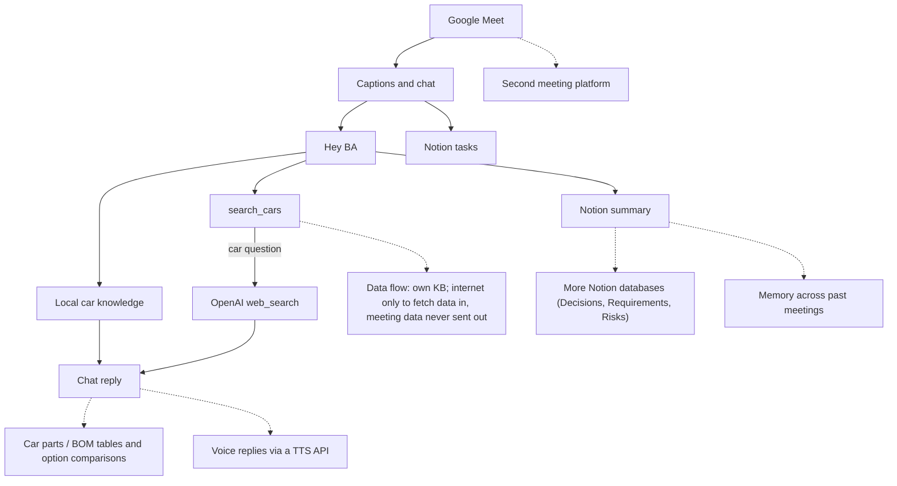

# TechSol BA

TechSol BA joins a Google Meet, keeps a caption transcript (who said what, and when), answers “Hey BA” in chat, and writes a summary plus tasks to Notion.

1. It joins Google Meet with the mic and camera off, does not decode other people's video, posts a consent line, and turns captions on.
2. It stores each caption with the speaker and a meeting clock such as `[01:15]`.
3. Say or type “Hey BA …” to ask a question. Car answers come from the local notes, then from public web search when the notes are not enough.
4. A complete overheard task (owner and due date) is saved and confirmed in chat.
5. “Hey BA, save the meeting”, or the meeting ending, writes the summary and transcript to Notion.



Solid arrows are the running agent. Dashed arrows are extensions and are not built. Source: [docs/diagrams/architecture.mmd](docs/diagrams/architecture.mmd) · Interactive HTML diagrams: [docs/techsol-ba-architecture.html](docs/techsol-ba-architecture.html) & [docs/techsol-ba-extensions.html](docs/techsol-ba-extensions.html).

## Setup

Python 3.11 or newer. From a checkout:

```bash
uv sync --extra dev
uv run playwright install chromium
cp .env.example .env
```

Put `BA_LLM__API_KEY` and `BA_NOTION__TOKEN` in `.env`. The process reads those names from the environment (`BA_LLM__API_KEY` or, if that is empty, `OPENAI_API_KEY`). Map the attached databases in [config/notion_schema.yaml](config/notion_schema.yaml), or set `BA_NOTION__DATABASES__SUMMARY` and `BA_NOTION__DATABASES__TASKS`. Empty database ids skip Notion until you attach one. `scripts/notion_setup.py` can create a sandbox when `BA_NOTION__PARENT_PAGE_ID` is set.

Join a meeting:

```bash
uv run python -m ba_agent join "https://meet.google.com/abc-defg-hij"
```

`GET http://127.0.0.1:8765/status` reports `captions_enabled` and `chat_enabled`. The same line is written to the log.

Docker, for a server with no display:

```bash
docker compose build
MEET_URL="https://meet.google.com/abc-defg-hij" docker compose up
```

The image is Playwright’s Python image plus Xvfb. It does not install a GPU runtime or a local model server. The browser profile and `data/state` are mounted so a restart can rejoin the same meeting. One meeting runs per process.

Render uses the same image. Chromium needs the Standard plan (2 GB RAM) or larger. [render.yaml](render.yaml) is a Blueprint: web service, one instance, health check on `/status`, and a 1 GB disk at `/var/data` for the browser profile and `meeting.db`.

1. Push this repo and in the Render dashboard choose **New → Blueprint**. Point it at `render.yaml`.
2. Fill in `MEET_URL`, `BA_LLM__API_KEY`, `BA_NOTION__TOKEN`, `BA_NOTION__DATABASES__SUMMARY`, and `BA_NOTION__DATABASES__TASKS` when Render asks. Change `BA_LLM__MODEL` if the key is not for `gpt-5.5`.
3. After the deploy, open `/status` on the service URL. The host still has to admit **TechSol BA**. Render sets join mode to `guest` because the instance has no display for a Google sign-in.

Change `MEET_URL` and redeploy to join a different meeting. The first image build is large. If the process is killed with no Python traceback, move the plan to Pro (4 GB). Google sometimes blocks data-center browsers; the logs then show `Not admitted` or `Join button not found`.

Cloudflare Containers runs this same image on the Workers Paid plan. Chromium needs about 2 GB of RAM, so the instance is `standard-1` (4 GiB memory, half a vCPU, 8 GB disk). [wrangler.jsonc](wrangler.jsonc) sets one instance. Included memory is 25 GiB-hours, about 6 hours on that size. The container sleeps after 3 hours without an incoming HTTP request, which covers one rehearsal and stays inside that allowance. A request resets the timer. Outbound Meet traffic does not, so there is no uptime monitor. Disk is ephemeral: after a sleep or a new deploy the browser profile and `meeting.db` are gone, so join mode is `guest`, the same choice as Render.

1. Confirm the account is Workers Paid.
2. `npm install`, then `npx wrangler login`.
3. Put `BA_LLM__API_KEY`, `BA_NOTION__TOKEN`, `BA_NOTION__DATABASES__SUMMARY`, and `BA_NOTION__DATABASES__TASKS` in `.env`.
4. Deploy (syncs those secrets plus `MEET_URL`, then builds the container):

```bash
npm run deploy -- --meet-url "https://meet.google.com/abc-defg-hij"
```

   Or set `MEET_URL` in `.env` / the shell and run `npm run deploy`. Secrets only: `npm run deploy:secrets -- --meet-url "…"`. First build is large; the image has to stay under the 8 GB disk.
5. Open `/status` on the workers.dev URL. The host still has to admit **TechSol BA**.
6. To point at a different meeting later (updates `.env` and the Worker secret):

```bash
npm run meet-url -- "https://meet.google.com/abc-defg-hij"
```

   Local `.env` only: `npm run meet-url -- --local "…"`. The new URL applies on the next container start. Deploy before the meeting. A deploy during a call sends SIGTERM and the bot leaves.
7. After the meeting, let the 3 hour timer fire. Hitting `/status` keeps the instance billed.
8. Google often blocks data-center browsers. Logs then show `Not admitted` or `Join button not found`. Do not add a proxy.

### Auto-join every Google Meet (Chrome Extension + Cloudflare)

Instead of updating `MEET_URL` before each call, the unpacked Chrome extension in [`extension/`](extension/) automatically sends `POST /join` with `{ "url": "https://meet.google.com/abc-defg-hij" }` to your Cloudflare Worker whenever you open or join a Google Meet, and can auto-admit **TechSol BA** when it knocks:

1. Deploy your Worker once with `npm run deploy` (optional: set `BA_WEBHOOK_SECRET` in `.env` if you want bearer-token authentication on `POST /join`).
2. In Chrome, open `chrome://extensions`, enable **Developer mode**, click **Load unpacked**, and select the [`extension/`](extension/) folder.
3. Click the **TechSol BA** extension icon, paste your `https://ba-meeting-agent.<subdomain>.workers.dev` URL (and optional `BA_WEBHOOK_SECRET`), and click **Save Settings**.
4. Whenever you open any `https://meet.google.com/xxx-xxxx-xxx` link, the extension automatically boots or switches the Cloudflare container to that meeting and auto-clicks **Admit** for **TechSol BA**.

## How to talk to it

Say or type “Hey BA” near the start of the line. `hey bea`, `hi ba`, `ok ba`, and a chat `@ba` count. “Hey BA” on its own gets one question back: “Yes — what would you like me to do?”

Car questions cite a knowledge file, for example `(src: hybrid.md)`, or a URL from web search. If neither source has the fact, the chat says it is not sure.

“Ali, please send the cost sheet by Friday” can create a task without “Hey BA”. Chat then shows `✓ Task added: Ali — cost sheet — Fri`. The same task again says it is already tracked. “Hey BA, add a task for Sara to book the test drive” asks for the missing due date and does not write a row yet.

“Hey BA, save the meeting” updates the summary page and posts `✓ Notes saved: <url>`. The transcript sits in a toggle on that page. Saving again updates the same page.

## Tech choices

Google Meet is driven by Playwright in a headed browser (Xvfb on a server). There is no hosted meeting bot. Incoming video is negotiated inactive, and Meet’s receive resolution is set to audio only when that control is on the page. Audio and captions stay on. `BA_BROWSER__RECEIVE_VIDEO=true` receives cameras again. The transcript is Meet’s own captions, not a second speech-to-text API. Replies use the OpenAI Responses API. Web search is the `web_search` tool, and that request body is only the car question plus one line telling the model to cite URLs. The meeting digest can go to the model for a reply, a task list, or the summary. It does not go into `search_cars`. The knowledge base is the Markdown files in `data/knowledge/`. Notion is called over HTTP. Property names live in `config/notion_schema.yaml`.

## Limits

Captions are English-biased, and Google can change the Meet DOM. Guest join still needs the host to admit “TechSol BA”. A signed-in profile is a volume, not something checked into git. Notion field names have to match the attached database or startup stops and names the missing properties. The live rehearsal in [docs/rehearsal.md](docs/rehearsal.md) has not been run yet. Run it before 30 Oct 2026.

## AI coding assistants

Cursor (Grok 4.7) drafted the package, tests, Docker and Cloudflare setup, this README, and the diagram from `docs/tasks/`. Adnan reviews that output before submission. The assistant did not join a live meeting. Details are in [AI_USAGE.md](AI_USAGE.md).
