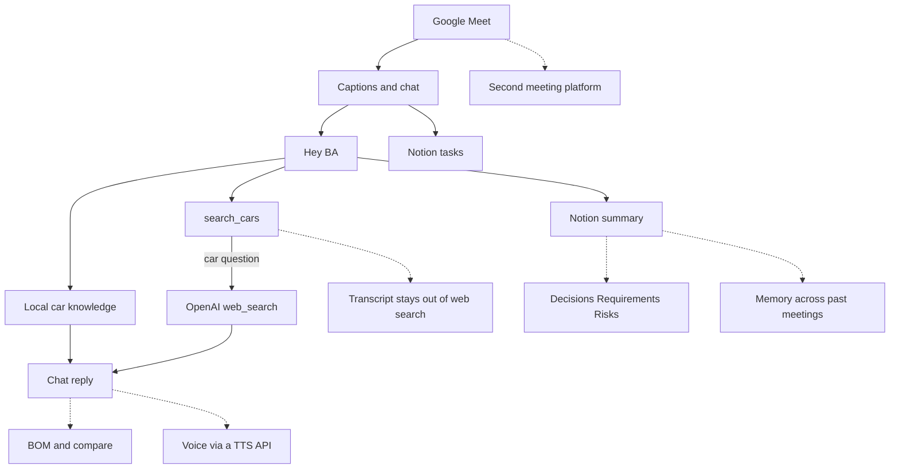

# TechSol BA

TechSol BA joins a Google Meet, keeps a caption transcript (who said what, and when), answers “Hey BA” in chat, and writes a summary plus tasks to Notion.

1. It joins Google Meet with the mic and camera off, posts a consent line, and turns captions on.
2. It stores each caption with the speaker and a meeting clock such as `[01:15]`.
3. Say or type “Hey BA …” to ask a question. Car answers come from the local notes, then from public web search when the notes are not enough.
4. A complete overheard task (owner and due date) is saved and confirmed in chat.
5. “Hey BA, save the meeting”, or the meeting ending, writes the summary and transcript to Notion.



Solid arrows are the running agent. Dashed arrows are extensions and are not built. Source: [docs/diagrams/architecture.mmd](docs/diagrams/architecture.mmd).

## Setup

Python 3.11 or newer. From a checkout:

```bash
uv sync --extra dev
uv run playwright install chromium
cp .env.example .env
```

Put `BA_LLM__API_KEY` and `BA_NOTION__TOKEN` in `.env`. The process reads those names from the environment (`BA_LLM__API_KEY` or, if that is empty, `OPENAI_API_KEY`). Map the attached databases in [config/notion_schema.yaml](config/notion_schema.yaml), or set `BA_NOTION__DATABASES__SUMMARY` and `BA_NOTION__DATABASES__TASKS`. Empty database ids skip Notion until you attach one. `scripts/notion_setup.py` can create a sandbox when `BA_NOTION__PARENT_PAGE_ID` is set.

Join a meeting:

```bash
uv run python -m ba_agent join "https://meet.google.com/abc-defg-hij"
```

`GET http://127.0.0.1:8765/status` reports `captions_enabled` and `chat_enabled`. The same line is written to the log.

Docker, for a server with no display:

```bash
docker compose build
MEET_URL="https://meet.google.com/abc-defg-hij" docker compose up
```

The image is Playwright’s Python image plus Xvfb. It does not install a GPU runtime or a local model server. The browser profile and `data/state` are mounted so a restart can rejoin the same meeting. One meeting runs per process.

## How to talk to it

Say or type “Hey BA” near the start of the line. `hey bea`, `hi ba`, `ok ba`, and a chat `@ba` count. “Hey BA” on its own gets one question back: “Yes — what would you like me to do?”

Car questions cite a knowledge file, for example `(src: hybrid.md)`, or a URL from web search. If neither source has the fact, the chat says it is not sure.

“Ali, please send the cost sheet by Friday” can create a task without “Hey BA”. Chat then shows `✓ Task added: Ali — cost sheet — Fri`. The same task again says it is already tracked. “Hey BA, add a task for Sara to book the test drive” asks for the missing due date and does not write a row yet.

“Hey BA, save the meeting” updates the summary page and posts `✓ Notes saved: <url>`. The transcript sits in a toggle on that page. Saving again updates the same page.

## Tech choices

Google Meet is driven by Playwright in a headed browser (Xvfb on a server). There is no hosted meeting bot. The transcript is Meet’s own captions, not a second speech-to-text API. Replies use the OpenAI Responses API. Web search is the `web_search` tool, and that request body is only the car question plus one line telling the model to cite URLs. The meeting digest can go to the model for a reply, a task list, or the summary. It does not go into `search_cars`. The knowledge base is the Markdown files in `data/knowledge/`. Notion is called over HTTP. Property names live in `config/notion_schema.yaml`.

## Limits

Captions are English-biased, and Google can change the Meet DOM. Guest join still needs the host to admit “TechSol BA”. A signed-in profile is a volume, not something checked into git. Notion field names have to match the attached database or startup stops and names the missing properties. The live rehearsal in [docs/rehearsal.md](docs/rehearsal.md) has not been run yet. Run it before 30 Oct 2026.

## AI coding assistants

Cursor (Grok 4.7) drafted the package, tests, Docker setup, this README, and the diagram from `docs/tasks/`. Adnan reviews that output before submission. The assistant did not join a live meeting. Details are in [AI_USAGE.md](AI_USAGE.md).
