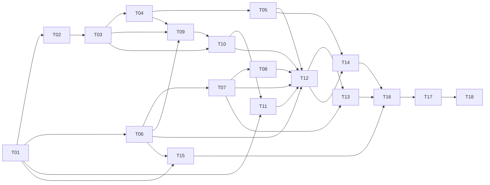

# BA Meeting Agent — Task Documents

Source of truth: [`../TechSol AI Engineer Assignment — Build a BA Meeting Agent.pdf`](../TechSol%20AI%20Engineer%20Assignment%20—%20Build%20a%20BA%20Meeting%20Agent.pdf) (Oct 13, 2026, @Raheel).

**Goal:** build "TechSol BA", an AI business analyst that joins a TechSol car-design meeting, stays silent unless someone says "Hey BA …", answers in chat within 10 s, keeps notes tagged with who said what and when, and writes tasks, decisions and requirements to four linked Notion databases. It runs with `docker compose up` on TechSol's 24 GB GPU VM, and the LLM is self-hosted by default.

Every task document uses the same sections:

| Section | Content |
|---|---|
| Why | The assignment requirement(s) it satisfies and why it matters |
| What | Scope: in / out |
| Details | Design and implementation notes, decisions, pitfalls |
| Acceptance criteria | Definition of done, checkable |
| Tests | Unit / integration / end-to-end tests with pass thresholds |
| Dependencies | Other tasks it needs |
| Related resources | Links to docs, libraries, references |

---

## Hard constraints from the assignment

These apply to every task. A change that breaks one of them is a bug.

| # | Constraint | Source in PDF |
|---|---|---|
| C1 | Self-hosted LLM by default; LLM swappable by config | "Deploy" row |
| C2 | No hosted bot services (e.g. Recall.ai, MeetingBaaS) and no hosted transcription services (e.g. Deepgram, AssemblyAI, OpenAI Whisper API). We also don't use the platform's own live captions as the transcript source (our interpretation; they are a hosted transcription service) | "Not allowed" |
| C3 | No public chatbots on meeting data (meeting content must not go to ChatGPT / Claude / Gemini etc. in the default config) | "Not allowed" |
| C4 | No hard-coded answers. Answers come from the pack, the meeting, and tools, never from canned Q→A tables | "Not allowed" |
| C5 | No real company data, no production accounts. Use only the provided accounts and the fictional pack | "Not allowed" |
| C6 | The agent never interrupts the meeting on its own and never invents specs, prices or suppliers | "How it should answer" |
| C7 | Chat replies are ≤ 6 lines or one small table. Numbers come with assumptions or a source doc. Every Notion write is confirmed in chat. Unclear requests get exactly one clarifying question | "How it should answer" |
| C8 | Reply in chat within 10 s of "Hey BA …" | "Meeting" row |
| C9 | AI coding assistants are allowed **if declared** (in the README) | "Resources" |

---

## Task list

| ID | Title | Priority | Depends on | Milestone |
|---|---|---|---|---|
| [T01](T01-project-setup.md) | Project setup, configuration and domain models | Must | — | M1 Foundations |
| [T02](T02-meeting-bot-google-meet.md) | Meeting bot: join Google Meet, chat I/O, consent notice | Must | T01 | M2 Meeting I/O |
| [T03](T03-audio-capture-and-stt.md) | Audio capture and speech-to-text (Listener) | Must | T01, T02 | M2 Meeting I/O |
| [T04](T04-speaker-tagging-and-timestamps.md) | Speaker tagging and timestamps | Must | T02, T03 | M2 Meeting I/O |
| [T05](T05-wake-word-trigger.md) | "Hey BA" trigger and question extraction | Must | T03, T04 | M2 Meeting I/O |
| [T06](T06-llm-provider.md) | Self-hosted LLM provider, swappable by config | Must | T01 | M1 Foundations |
| [T07](T07-knowledge-rag.md) | Automotive knowledge pack ingestion and RAG (`search_knowledge`) | Must | T01, T06 | M3 Brain & Notion |
| [T08](T08-bom-and-compare.md) | Car parts, BOM and trade-off tools (`build_bom`, `compare`) | Must | T07 | M3 Brain & Notion |
| [T09](T09-transcript-classifier.md) | Transcript classifier (Decision / Task / Question / Risk / Requirement / Note) | Must | T03, T04, T06 | M3 Brain & Notion |
| [T10](T10-short-term-memory.md) | Short-term meeting memory and recall | Must | T03, T09 | M3 Brain & Notion |
| [T11](T11-notion-integration.md) | Notion: 4 linked databases and write tools | Must | T01, T10 | M3 Brain & Notion |
| [T12](T12-agent-core-persona-tools.md) | Agent core: persona, tool calling, reply rules | Must | T05, T06, T07, T08, T10, T11 | M3 Brain & Notion |
| [T13](T13-guardrails.md) | Guardrails: off-topic, unsafe, "not sure", no invented numbers | Must | T07, T12 | M3 Brain & Notion |
| [T14](T14-latency-budget.md) | Latency budget, instrumentation and tuning (≤ 10 s) | Must | T05, T12 | M4 Hardening |
| [T15](T15-docker-deployment.md) | Docker Compose and deployment to the GPU VM | Must | T01, T06 (grows with all) | M1 → M4 |
| [T16](T16-live-test-rehearsal.md) | Live-test scenario, evaluation harness and rehearsals | Must | All Must tasks | M4 Hardening |
| [T17](T17-readme-diagrams-submission.md) | README, two diagrams, Notion export, submission | Must | All Must tasks | M5 Submission |
| [T18](T18-bonus-features.md) | Bonus: Risks DB, cross-meeting memory, voice replies, second platform | Bonus (+10) | Must tasks done | M5 Bonus |

### Suggested order

1. **M1 Foundations:** T01, T06, and a T15 skeleton (compose with Ollama + Qdrant running on the VM early).
2. **M2 Meeting I/O:** T02 first (it carries the highest risk: logging in, admission, DOM selectors), then T03, T04, T05.
3. **M3 Brain & Notion:** T07 and T08 (start as soon as the pack arrives), T09, T10, T11, then T12 and T13, which need the others. T11's client, schema validation and sandbox setup can start in parallel with M2. Only its memory-backed parts (dedup lookups, `save_meeting` content) wait for T10.
4. **M4 Hardening:** T14, T16. Rehearse at least twice on the real VM.
5. **M5 Submission:** T17, then T18 if time remains (Risks DB first; it is the cheapest bonus).

---

## Requirement traceability

Every row of the assignment maps to at least one task.

### What to build

| Area | Requirement (abridged) | Tasks |
|---|---|---|
| Meeting | Joins Meet/Zoom/Teams as "TechSol BA"; replies in chat within 10 s to "Hey BA …"; silent otherwise | T02, T05, T12, T14 |
| Notes | Decisions, tasks, questions, risks, every line tagged with speaker + timestamp | T03, T04, T09, T11 |
| Notion | 4 linked DBs (Meeting Notes, Tasks, Decisions, Requirements); tasks have owner, due date, status; no duplicates | T11 |
| Knowledge | EV, chassis, NCAP, ADAS, regulation, BOM; user stories, MoSCoW; says "not sure" instead of inventing | T07, T12, T13 |
| Car parts | Main parts by system; BOM table (part, qty, est. cost, supplier) from the parts pack; flags single-supplier and long-lead parts | T08 |
| Memory | Recalls earlier points in the same meeting | T10 |
| Deploy | `docker compose up` on the TechSol VM; LLM swappable by config, self-hosted by default | T06, T15 |
| Bonus | Voice replies, second platform, cross-meeting memory, Risks DB | T18 |

### The AI agent

| Part | Tasks |
|---|---|
| Role & persona (neutral, concise, never takes sides, asks for owner/date when missing) | T12 |
| Listener (audio → STT, rolling transcript with speaker + time) | T03, T04 |
| Trigger ("Hey BA" detection + question extraction; ignores everything else) | T05 |
| Classifier (Decision / Task / Question / Risk / Requirement / Note) | T09 |
| Reasoning (plans, picks tool, writes reply) | T06, T12 |
| Knowledge / RAG (searches pack first, cites source doc) | T07 |
| Short-term memory (decisions, tasks, earlier answers) | T10 |
| Long-term memory (bonus) | T18 |
| Guardrails (refuse off-topic/unsafe; "not sure" when the pack has no answer) | T13 |

### Tools the agent must call (exact signatures)

| Tool | Tasks |
|---|---|
| `post_chat(text)` | T02 (implementation), T12 (exposed to the agent) |
| `search_knowledge(query)` | T07 |
| `create_task(task, owner, due, said_by, time)` | T11 |
| `update_task(task, status)` | T11 |
| `log_decision(decision, by, time, reason)` | T11 |
| `add_requirement(story, criteria, moscow)` | T11 |
| `build_bom(system)` | T08 |
| `compare(option_a, option_b, criteria)` | T08 |
| `save_meeting()` | T11 |

### How it should answer

| Rule | Tasks |
|---|---|
| ≤ 6 lines or one small table | T12 |
| Numbers with assumptions or a source doc | T07, T08, T13 |
| Confirms every Notion write in chat | T11, T12 |
| One clarifying question when unclear | T12 |
| Never interrupts on its own | T05, T12 |
| Never invents specs, prices, suppliers | T08, T13 |

### Live test and submission

| Item | Tasks |
|---|---|
| Live test (consent notice, 60 vs 75 kWh comparison, battery decision, tasks from speech and on request, user stories, 60 kWh pack parts + suppliers + cost, recall the decision, fill Notion, post link) | T16 (scenario), every Must task |
| Code + Docker + config | T15 |
| Two diagrams | T17 |
| Notion export | T17 |
| README: setup, tech choices, answers to platform choice / latency budget / wake-word design / speaker tagging / stopping invented specs | T17 (answers drafted in T02, T14, T05, T04, T13) |

---

## Effort, schedule and cut list

Estimates from the task headers, for one engineer working sequentially:

| Milestone | Tasks | Days |
|---|---|---|
| M1 Foundations | T01, T06, T15 skeleton | ~3.5 |
| M2 Meeting I/O | T02, T03, T04, T05 | ~10 |
| M3 Brain & Notion | T07, T08, T09, T10, T11, T12, T13 | ~16 |
| M4 Hardening | T14, T16, T15 final | ~6 |
| M5 Submission | T17 | ~1.5 |
| **Total (Must)** | | **~37** |
| Bonus | T18 (B1 → B4) | 0.5–3 each |

The submission deadline is not in the PDF (question Q1). If time is short, cut in this order, because each item is an optimisation or a fallback rather than a PDF requirement:

1. T04 pyannote diarization fallback (keep the UI-based tagging).
2. T07 reranker and the optional primer; T06 14B benchmark (keep 7B vs 8B).
3. T16 audio-replay mode with actor browsers (keep text replay plus human rehearsals).
4. T02 soak test length (60 → 30 min); T15 fresh-install test by a teammate.
5. Second human rehearsal, only if the first one is clean.

Do **not** cut: the output gate (T02), template fast paths and the output validator (T12/T13), the deadline fallback (T14), dedup (T11), or the first human rehearsal (T16).

### Top risks (watch from week 1)

| Risk | Early signal | Mitigation |
|---|---|---|
| Google blocks the bot's sign-in from the VM | "This browser or app may not be secure" during the T02 spike | Guest join mode (host admits "TechSol BA"); persistent profile signed in via noVNC |
| Pack arrives late or as PDF tables | No pack by end of M1 | Synthetic fixture pack; `pdfplumber` table extraction; `pack_mapping.yaml` |
| Provided Notion schema doesn't match ours / can't be extended | Startup validation diff | Schema mapping file; fuzzy dedup without a `Key` property |
| 7B model picks the wrong tool or arguments | T06-I1 < 90% | Few-shot tool examples in the prompt; try `qwen2.5:14b`; deterministic fast paths |
| GPU contention pushes answers past 10 s | T14-P2 p95 > 8 s with the classifier running | Priority lanes, longer classifier batches, smaller STT model, deadline fallback |
| Host disables participant chat in Meet | `/status` shows `chat_enabled: false` | Runbook request to the host; nothing else possible |

---

## Assumptions and open questions

The full list, with plain-language explanations and examples, is in [`../QUESTIONS.md`](../QUESTIONS.md) (39 questions, each with a priority and a working assumption). Ask the **Blocking** ones first: Q1, Q2, Q4, Q5, Q6, Q11, Q21, Q22, Q24, Q27, Q28, Q32, Q33.

Until TechSol answers, the tasks proceed on these assumptions (IDs match `QUESTIONS.md`):

| # | Question | Working assumption | Affects |
|---|---|---|---|
| Q6 | Which platform and what kind of account? | Google Meet via a self-hosted browser bot; signed-in account, guest join as fallback (`meeting.join_mode`) | T02–T05, T15 |
| Q9 | Is "Hey BA" spoken, typed in chat, or both? | Both. Speech is the main path | T05 |
| Q10 | "Hey BA" then silence? | One clarifying question | T05, T12 |
| Q11 | Write tasks/decisions heard in conversation automatically, with chat confirmations? | Yes, above confidence thresholds; confirmations immediate, `batched` mode available | T09, T11, T12 |
| Q12 | Timestamp format | Meeting clock `[mm:ss]` in chat and notes; wall time also stored | T04, T11 |
| Q13 | When does `save_meeting()` run; transcript in Notion? | On request and at meeting end; re-runnable; transcript in a toggle | T11 |
| Q14 | Where is the Notion link posted? | In the consent notice and after `save_meeting()` | T02, T11 |
| Q15 | "Small table" and "line" | Header + ≤ 8 rows, ≤ 5 columns; a line ≤ 120 chars | T08, T12 |
| Q17 | Language, timezone, currency | English; `meeting.timezone`; USD | T03, T09, T11 |
| Q18 | Meet live captions allowed? | Treated as a hosted transcription service; not used | T03 |
| Q21–Q24 | Notion schema, extra properties, Owner type, token | Configurable mapping + startup validation; sandbox copy for development | T11 |
| Q25 | Dedup scope | Current meeting only; rehearsal rows archived before the live test | T11, T16 |
| Q27–Q29 | Pack format and contents; "long-lead" definition | Support PDF/MD/DOCX/CSV/XLSX; missing values shown as "not in pack"; long-lead ≥ 12 weeks | T07, T08 |
| Q30–Q31 | General knowledge answers; derived maths | Allowed, labelled; formulas shown | T07, T08, T13 |
| Q32–Q33 | VM details and access | Ubuntu 22.04, driver present, SSH, exclusive GPU | T15 |
| Q36 | The "two diagrams" | Architecture / deployment + "Hey BA" sequence with latency budget | T17 |

Other standing assumptions: one meeting at a time per agent process (T15); the bot replies only in chat (voice is bonus T18); the meeting account is a dedicated test account (C5).

---

## Glossary

- **Utterance:** one speech segment between pauses (from voice activity detection), transcribed, with speaker, start and end time. Also called a "transcript chunk" in the PDF.
- **Meeting clock:** time since the bot was admitted, shown as `[mm:ss]`. Absolute UTC time is stored alongside.
- **Pack:** the fictional automotive pack TechSol provides (Falcon specs, parts list / BOM, supplier list).
- **Write confirmation:** the chat line posted after a successful Notion write, e.g. `✓ Task added: Ali — cost sheet — Fri`.
- **Interactive lane / background lane:** LLM request priorities. Answers to "Hey BA" always go before classification and summarisation (T06).
