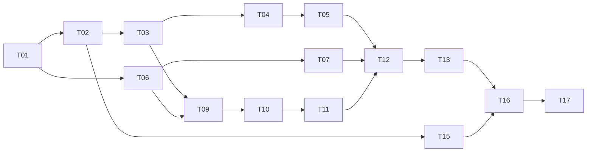

# BA Meeting Agent — Task Documents

Source of truth: [`../TechSol_AI_Engineer_Assignment_new.pdf`](../TechSol_AI_Engineer_Assignment_new.pdf) (TradeOrigin · 1-day task).

The Oct 13 brief ([`../TechSol AI Engineer Assignment — Build a BA Meeting Agent.pdf`](../TechSol%20AI%20Engineer%20Assignment%20—%20Build%20a%20BA%20Meeting%20Agent.pdf)) is superseded. Decisions from that change are in [`../ANSWERS.md`](../ANSWERS.md) under “Revision — 25 Oct 2026”.

**Goal:** build “TechSol BA”. It joins a Google Meet, writes down what is said with who said it and when, replies in chat when someone says “Hey BA”, answers car questions from a knowledge base we build (and from OpenAI web search when the base does not have the fact), and saves a summary plus tasks (owner + due date) to Notion.

Deadline already answered: **30 Oct 2026**. The new brief is a one-day build. The old ~37-day plan is retired.

Every task document uses the same sections: Why, What, Details, Acceptance criteria, Tests, Dependencies, Related resources.

---

## What changed

| Topic | Now |
|---|---|
| Speech-to-text | Google Meet live captions, read from the bot’s own Meet window. No second STT API (no Whisper, Deepgram, or AssemblyAI). |
| LLM | The provided API key. Default is **OpenAI** (Responses API). Claude or Gemini stay swappable by config. |
| Car facts | A knowledge base we author, plus OpenAI **web search** to fetch public car facts in. Search queries are the car question. The meeting transcript is not the search query. |
| Text-to-speech | Allowed (OpenAI speech API). Voice replies are an extension on the diagram. Today the bot replies in chat. |
| Notion | Summary + tasks (owner + due date). The Notion database will be attached separately; map to it when it arrives. Decisions, Requirements, and Risks are diagram-only. |
| BOM, option compare, second platform, cross-meeting memory, voice | Diagram only. Do not build. |
| Submit | Code, **one** diagram (today’s build + extensions), a short README. |
| Given | Cloud server, LLM API key, Notion workspace. No GPU VM and no fictional Falcon pack in this brief. |

---

## Hard constraints

These apply to every task.

| # | Constraint | Source |
|---|---|---|
| C1 | Join with our own Google Meet bot (Playwright). Do not depend on a hosted meeting bot (Recall.ai and similar). | Platform choice; we need the caption DOM |
| C2 | Transcript comes from Meet captions in the bot’s browser. Do not add another speech-to-text API. | Adnan, 25 Oct 2026 |
| C3 | Answers use the provided LLM API. Default provider is OpenAI. The model is swappable by config. | New brief “What we give you”; Adnan |
| C4 | Car lookups may call OpenAI web search. The search input is the car question. Do not put the transcript, participant list, or Notion contents into the search query. | New brief data-flow line; Adnan |
| C5 | No hard-coded question→answer tables. Facts come from the knowledge base or a cited web result. | New brief; carried from the old “no hard-coded answers” rule |
| C6 | No real company data and no production accounts. | Carried forward |
| C7 | The agent replies in chat when addressed with “Hey BA”, and stays quiet otherwise. It does not invent a car fact when both the knowledge base and web search come back empty. | New brief items 3–4 |
| C8 | Notion writes for this build are a meeting summary and tasks with owner and due date. Confirm each task write in chat. | New brief item 5; earlier answer on confirmations |
| C9 | Voice replies and the other extension items are drawn, not built. A text-to-speech API is allowed if voice is added later. | New brief “Extension (diagram only)”; Adnan |
| C10 | Declare AI coding assistants in the README. | Carried forward |

The old bans on hosted LLMs, on Meet captions, and on a 10-second reply limit are gone. Do not build for them.

---

## Task list

| ID | Title | Priority | Depends on |
|---|---|---|---|
| [T01](T01-project-setup.md) | Project setup, configuration, domain models | Must | — |
| [T02](T02-meeting-bot-google-meet.md) | Join Google Meet, chat, consent, turn captions on | Must | T01 |
| [T03](T03-audio-capture-and-stt.md) | Transcript from Google Meet captions | Must | T01, T02 |
| [T04](T04-speaker-tagging-and-timestamps.md) | Speaker and time from caption lines | Must | T02, T03 |
| [T05](T05-wake-word-trigger.md) | “Hey BA” on captions and in chat | Must | T03, T04 |
| [T06](T06-llm-provider.md) | OpenAI client, swappable provider | Must | T01 |
| [T07](T07-knowledge-rag.md) | Car knowledge base + web search | Must | T01, T06 |
| [T08](T08-bom-and-compare.md) | BOM and option comparisons | Diagram only | — |
| [T09](T09-transcript-classifier.md) | Pull tasks (owner + due) out of the transcript | Must | T03, T06 |
| [T10](T10-short-term-memory.md) | This meeting’s transcript and task list | Must | T03, T09 |
| [T11](T11-notion-integration.md) | Save summary and tasks to Notion | Must | T01, T10 |
| [T12](T12-agent-core-persona-tools.md) | Persona, tools, chat replies | Must | T05, T06, T07, T10, T11 |
| [T13](T13-guardrails.md) | Citations, empty-result “not sure”, search privacy | Must | T07, T12 |
| [T14](T14-latency-budget.md) | Timing logs | Optional | T05, T12 |
| [T15](T15-docker-deployment.md) | Run on the cloud server | Must | T01, T02 |
| [T16](T16-live-test-rehearsal.md) | Short live-test rehearsal | Must | Must tasks |
| [T17](T17-readme-diagrams-submission.md) | Short README and one diagram | Must | Must tasks |
| [T18](T18-bonus-features.md) | Extensions to draw, including voice | Diagram only | — |

### Order

1. T01 and T06, so the OpenAI key and config exist.
2. T02, then T03 and T04 (captions are the risky part), then T05.
3. T07 (a small knowledge base plus web search) in parallel with the bot.
4. T09, T10, T11 once the Notion database is attached. Until then, use a sandbox database with Task, Owner, Due, and a summary page.
5. T12 and T13 wire the reply loop.
6. T15 so it runs on the cloud server. T16 is one rehearsal. T17 is the README and the single diagram.

T08, T14, and T18 are outside this graph. T08 and T18 are drawn in the T17 diagram. T14 is optional timing logs.

---

## Requirement traceability

| New brief | Tasks |
|---|---|
| Join Google Meet, Zoom, or Teams (we pick Meet) | T02, T15 |
| Write down what is said, with who and when | T03, T04, T10 |
| Reply in chat when someone says “Hey BA” | T05, T12 |
| Answer car questions from a knowledge base we build | T07, T12, T13 |
| Find cars on the web via the OpenAI API | T06, T07 |
| Save a summary and tasks (owner + due date) to Notion | T09, T11 |
| One diagram: today’s build plus extensions | T17, with T08 and T18 as the extension content |
| Text-to-speech allowed, not built | T18 |

### Tools the agent calls

| Tool | Task |
|---|---|
| `post_chat(text)` | T02, T12 |
| `search_knowledge(query)` | T07 |
| `search_cars(query)` | T06, T07 |
| `create_task(task, owner, due, said_by, time)` | T11 |
| `save_meeting()` | T11 |

`build_bom`, `compare`, `log_decision`, `add_requirement`, and voice are extension labels on the diagram.

---

## One-day cut list

Build the Must rows. If the day slips, drop in this order:

1. T14 timing report.
2. Fuzzy wake-phrase matching (keep the exact variant list).
3. Cross-meeting task dedup (keep dedup inside the current meeting).
4. Signed-in Google profile (guest join still works if the host admits “TechSol BA”).

Do not drop: captions, chat replies, the knowledge base, web search for car questions, Notion summary and tasks, the diagram.

### Risks

| Risk | What we do |
|---|---|
| Meet caption DOM changes | Selectors live in one file, with an ARIA fallback (`role="region"`, name contains “aption”). Screenshot on failure. |
| Captions stay off or stay empty | The bot turns captions on for itself. Typed “Hey BA” in chat still works. We do not add a second STT API. |
| Google blocks sign-in from the server | Guest join; the host admits “TechSol BA”. |
| Notion database arrives late | Sandbox with Task, Owner (text), Due (date), and a summary page. Remap when the real database is attached. |
| Web search is slow or cites a weak page | Answer from the local knowledge base first. Search only for the gap. Show the URL. If both are empty, say we are not sure. |
| A search query would include meeting text | `search_cars` accepts only the car question string. |

---

## Standing decisions

Full Q&A history is in [`../QUESTIONS.md`](../QUESTIONS.md) and [`../ANSWERS.md`](../ANSWERS.md). These are the ones the build follows:

| Topic | Decision |
|---|---|
| Platform | Google Meet |
| “Hey BA” | Spoken (via captions) and typed in chat |
| Reply channel | Chat. TTS is allowed and is not built |
| “Hey BA” then silence | One short clarifying question in chat |
| Tasks overheard in speech | Write them to Notion and confirm in chat |
| Decisions, requirements, risks | Mentioned in the summary if they came up. Separate databases are diagram-only |
| Timestamps | Meeting time `[mm:ss]` from when the bot was admitted |
| `save_meeting()` | On request and when the meeting ends |
| Notion link | In the first chat message and again after save |
| Leave | 1 minute after everyone else has left, or when told |
| Language, dates, money | English; timezone from config (default UTC); dates like `24 Oct`; USD |
| Dedup | Against tasks already stored for past meetings as well as this one, once the real database is attached. Tell the chat if the task already exists |
| Owner | Text. Store the name as given |
| Notion schema | Pending the database Adnan will attach. Sandbox names until then |

---

## Glossary

- **Caption line:** one stable line from Meet’s captions region: speaker, text, and the meeting time we observed it.
- **Meeting clock:** time since the bot was admitted, shown as `[mm:ss]`.
- **Knowledge base:** the car notes we write and ship in the repo (`data/knowledge/`).
- **Web search:** OpenAI Responses API tool `web_search`, used to fetch public car facts. The query is the car question.
- **Write confirmation:** the chat line after a Notion task write, for example `✓ Task added: Ali — cost sheet — Fri`.
